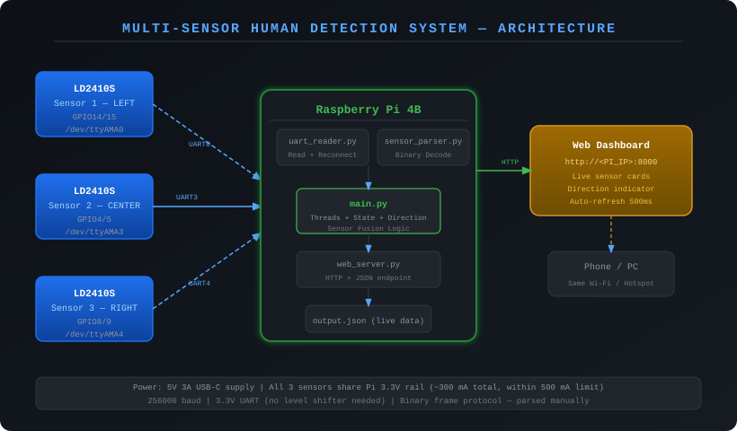
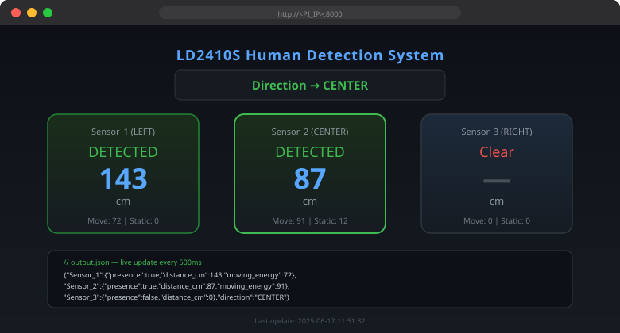

# LD2410S multi-sensor human detection on Raspberry Pi

Three HLK-LD2410S 24 GHz mmWave radar modules connected to a Raspberry Pi 4B over
three hardware UARTs. The Pi decodes the radar frames, works out whether a person
is present, how far away they are and roughly which side they are on (left,
centre, right), and serves the result on a small web dashboard.

The frame parser and the web server are written against the Python standard
library; the only dependency is `pyserial`.



## What it does

- Reads three radar sensors at the same time, one thread per UART.
- Decodes the LD2410S binary reporting frames (header `F4 F3 F2 F1`, footer
  `F8 F7 F6 F5`) into presence, moving/stationary distance and signal energy.
- Estimates direction from the sensor that reports the closest target.
- Reconnects on its own if a serial port drops out.
- Writes the latest state to `output.json` twice a second and serves it, together
  with a dashboard page, on port 8000.

## Dashboard



*Illustration of the dashboard layout with example values.*

The page polls `/output.json` every 500 ms and shows one card per sensor
(presence, distance, moving and static energy) plus the estimated direction.
Open it from any device on the same network at `http://<PI_IP>:8000`.

## Hardware

| Component | Notes |
|---|---|
| Raspberry Pi 4B | any RAM size |
| LD2410S radar module x 3 | 3.3 V logic, UART, 256000 baud |
| 5 V / 3 A USB-C supply | under-powered supplies cause undervoltage resets |
| Female-female jumper wires | about 15 |

### Wiring

| Sensor | Position | UART device | Pi TX | Pi RX |
|---|---|---|---|---|
| 1 | left | `/dev/ttyAMA0` | GPIO14 (pin 8) | GPIO15 (pin 10) |
| 2 | centre | `/dev/ttyAMA3` | GPIO4 (pin 7) | GPIO5 (pin 29) |
| 3 | right | `/dev/ttyAMA4` | GPIO8 (pin 24) | GPIO9 (pin 21) |

TX and RX are crossed: the sensor's `OT1` (TX) goes to the Pi RX pin and the
sensor's `RX` goes to the Pi TX pin. The sensors are powered from the Pi's 3.3 V
rail. Full pin tables are in [docs/hardware_setup.md](docs/hardware_setup.md).

## Setup

1. Clone the repository on the Pi.

   ```bash
   git clone https://github.com/GaganManjunath013/ld2410-human-detection.git
   cd ld2410-human-detection
   ```

2. Enable the extra UARTs. Add the following to `/boot/config.txt`
   (`/boot/firmware/config.txt` on newer Raspberry Pi OS) and reboot.

   ```ini
   enable_uart=1
   dtoverlay=disable-bt
   dtoverlay=uart3
   dtoverlay=uart4
   ```

3. Turn off the serial login console: `sudo raspi-config`, then
   *Interface Options > Serial Port*, login shell **No**, serial hardware **Yes**.

4. Install the dependency and add your user to the `dialout` group.

   ```bash
   bash setup.sh
   ```

   Log out and back in so the group change takes effect.

5. Check that the ports exist and that each sensor is sending data.

   ```bash
   ls /dev/ttyAMA*
   python3 test_uart.py
   ```

6. Start the system.

   ```bash
   python3 src/main.py
   ```

   The console shows a live summary, and the dashboard is at
   `http://<PI_IP>:8000` (`hostname -I` prints the address).

The reasoning behind each `config.txt` line is in
[docs/uart_config.md](docs/uart_config.md).

## Repository layout

```
src/
  main.py            entry point: reader threads, direction logic, console output
  uart_reader.py     serial port wrapper with automatic reconnect
  sensor_parser.py   LD2410S frame decoder (run it directly for a self-test)
  web_server.py      HTTP server for the dashboard and output.json
docs/
  hardware_setup.md  components, pinout and wiring
  uart_config.md     UART overlay configuration
  troubleshooting.md common problems and fixes
  architecture.svg, dashboard_preview.svg
test_uart.py         checks that all three UARTs receive data
setup.sh             one-time setup on the Pi
requirements.txt
```

## Troubleshooting

| Problem | First thing to check |
|---|---|
| `/dev/ttyAMA*` missing | `config.txt` syntax, no spaces around `=` |
| `Permission denied` on a port | user is in the `dialout` group, then re-login |
| No data from a sensor | TX and RX are crossed |
| Still no data | some modules ship at 115200 baud; change `BAUD_RATE` in `src/main.py` |
| Dashboard not loading | same network, correct IP, port 8000 not blocked |
| Undervoltage warning | use a 5 V / 3 A supply and a good cable |

More detail in [docs/troubleshooting.md](docs/troubleshooting.md).

## Possible extensions

- Start automatically at boot as a systemd service.
- Publish detections over MQTT for Node-RED or Grafana.
- Tag detections with GPS position.
- Add a camera for visual confirmation.
- Send an alert (SMS or e-mail) on detection.

## Author

Gagan Manjunath, Electronics and Communication Engineering.
Built as part of the CSR Body Detection Sensor Network project.

## License

Released under the [MIT License](LICENSE).
